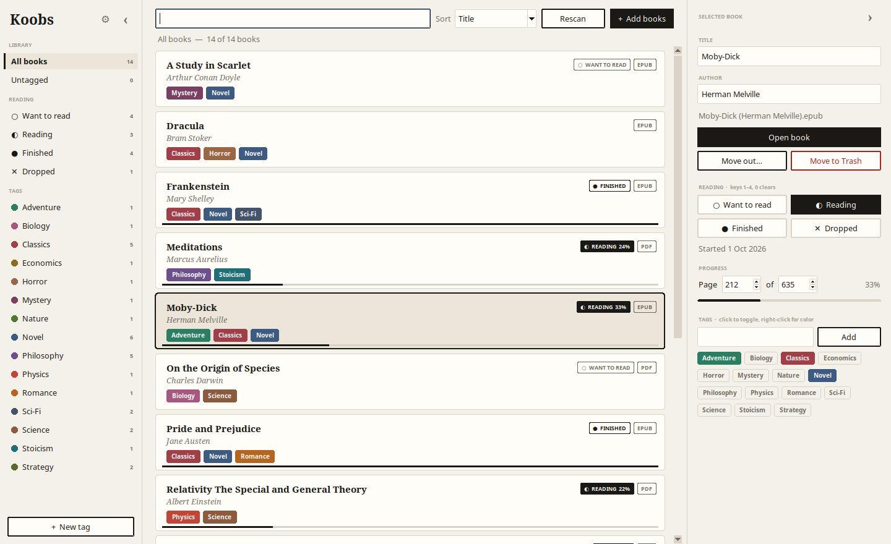
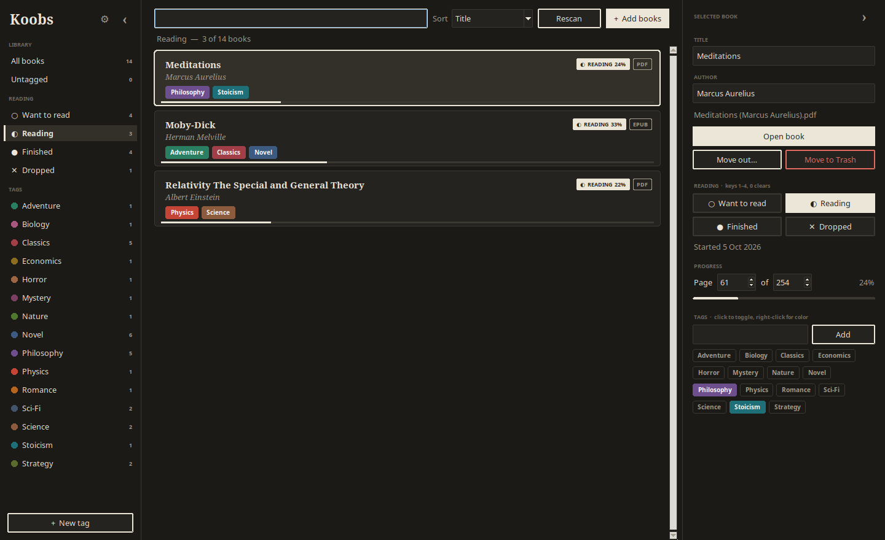
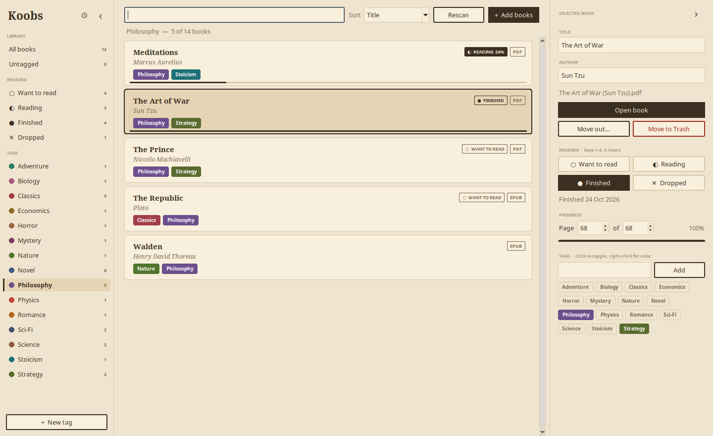
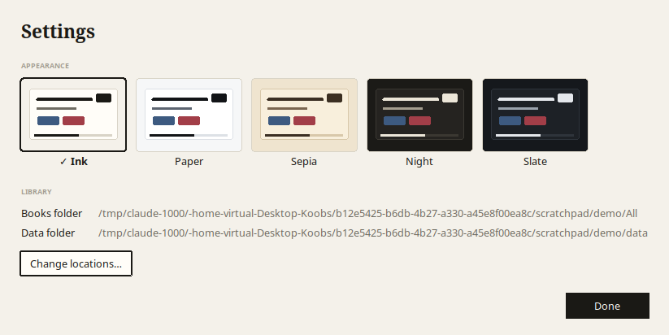

<h1 align="center">📚 Koobs</h1>

<p align="center">
  <b>Your ebook folder, finally organized.</b><br>
  Tag it. Track it. Find it. Read it, in a calm, ink-on-paper desktop app.
</p>

<p align="center">
  
  
  
  
</p>

<p align="center">
  
</p>

---

## Why Koobs?

You have a folder of PDFs and EPUBs. Hundreds of them, maybe. Names like
`Meditations (Marcus Aurelius) (z-lib.org).pdf`. You know there's a great physics
book in there somewhere, and you started *something* last month but can't remember what.

**Koobs turns that folder into a library you actually want to open:**

- 🏷️ **Tag anything.** Colored tags, as many per book as you like, and filters that stack.
- 📖 **Know where you are.** Want to read, Reading, Finished, Dropped, with page progress drawn right on the card.
- 🔎 **Find it in a keystroke.** Live search across titles, authors and file names.
- 🎨 **Make it yours.** Five hand-tuned themes, from warm paper to deep night.
- 🪶 **Weightless.** Pure Python, no installs, starts instantly, and your files stay where they are.

---

## Get started

Koobs runs on **Linux, Windows and macOS**. All you need is **Python 3.10+**.

<table>
<tr><th>🐧 Linux</th><th>🪟 Windows</th><th>🍎 macOS</th></tr>
<tr valign="top"><td>

```sh
git clone <this repo> koobs
cd koobs
./run.sh
```
Missing Tkinter? Run<br>`sudo apt install python3-tk`

</td><td>

1. Install Python from [python.org](https://www.python.org/downloads/). Tick **"Add python.exe to PATH"**.
2. **Code → Download ZIP** on GitHub, then unzip.
3. Double-click **`Koobs.pyw`** (or `Koobs.bat`).

</td><td>

1. Install Python from [python.org](https://www.python.org/downloads/). It includes Tkinter.
2. Clone or download the repo.
3. In Terminal:
```sh
cd koobs && ./run.sh
```

</td></tr>
</table>

That's it. On first launch Koobs asks two questions:

> **Where are your books?** → any folder (subfolders included)
> **Where should Koobs keep its notes?** → defaults to a hidden `.local/` folder right here

<sub>Koobs fits in with each system: books open in your default reader, and deleted books go to the
Trash (Linux, macOS) or the Recycle Bin (Windows). On Linux, <code>zenity</code> gives native file pickers when it's installed.</sub>

---

## A quick tour

### 🏷️ Tags that stay out of your way
Every tag gets its own color. Click a tag in the sidebar to filter, or **Ctrl-click** several to
narrow down ("Philosophy **and** Strategy"). Select ten books and click a tag chip to tag all ten
at once. Right-click any tag to recolor, rename or merge it.

### 📖 Reading status, at a glance
Mark books as **○ Want to read · ◐ Reading · ● Finished · ✕ Dropped**. Use a button, a
right-click, or just press **1–4**. Koobs notes when you started and finished. Enter
*page 212 of 635* and a thin progress line appears along the bottom of the card.

<p align="center">
  <br>
  <sub>Everything you're currently reading, in the <b>Night</b> theme.</sub>
</p>

### ➕ Adding and tidying up
- **+ Add books:** pick files, copy *or* move them in, and tag them in the same step. Exact duplicates are skipped, and name clashes get `(2)` added automatically.
- **Move out…:** send books to another folder when you're done with them.
- **Move to Trash:** they land in your desktop Trash, so it can be undone.

Nothing destructive happens without a confirmation, and **Cancel** is always the default.

### ☁️ Sync with Google Drive (Linux)
Keep your books, tags and reading progress the same on all your Linux computers.
Open **⚙ Settings → Sync**, click **Connect Google Drive**, and sign in. Then:

- **⟳ Sync** in the toolbar syncs on demand, and Koobs also syncs when it opens and closes.
- On a new computer: install Koobs, connect the same Drive, and everything (books, tags, statuses, pages) downloads.
- Edits from different computers are **merged**, never overwritten. If the same book was changed on both, the newer change wins.
- A book removed on one computer goes to the **Trash** on the others, so it can still be restored. If many books would go at once, Koobs asks first.
- Koobs can only see the `Koobs` folder it creates in your Drive, nothing else.

<sub>Sync uses <a href="https://rclone.org">rclone</a>: <code>sudo apt install rclone</code>. Your window layout and folder paths stay local to each computer.</sub>

### 🎨 Five themes, switched live
**Ink** · **Paper** · **Sepia** · **Night** · **Slate.** Pick one in ⚙ **Settings** and the whole app
changes instantly, with no restart.

<p align="center">
  
  
</p>

### 🪟 A layout that bends
Drag the panel edges to resize, or close them with **‹ ›** for a distraction-free list. Koobs
remembers your layout, window size and theme.

---

## ⌨️ Keyboard

| Key | Does |
|---|---|
| <kbd>↑</kbd> <kbd>↓</kbd> | move through books |
| <kbd>Enter</kbd> / double-click | open the book |
| <kbd>Ctrl</kbd>+<kbd>A</kbd> | select everything visible |
| <kbd>1</kbd> <kbd>2</kbd> <kbd>3</kbd> <kbd>4</kbd> | Want to read · Reading · Finished · Dropped |
| <kbd>0</kbd> | clear status |
| <kbd>Delete</kbd> | move to Trash (asks first) |
| <kbd>Ctrl</kbd>+<kbd>[</kbd> · <kbd>Ctrl</kbd>+<kbd>]</kbd> | toggle tags panel · details panel |

---

## 🔒 Your data, your files

Koobs never renames or reorganizes your books. All it keeps is a small JSON notebook:

```
config.json        where your books and data live, plus your theme
<data>/library.json   tags, colors, statuses, page progress
<data>/ui.json        panel sizes, window size
```

`config.json` lives in your system's usual settings folder: `~/.config/koobs/` on Linux,
`%APPDATA%\Koobs\` on Windows, and `~/Library/Application Support/Koobs/` on macOS.

- Point Koobs at a different folder (even a parent or child of the old one) and every tag, status and page number is **re-mapped automatically**. Nothing is duplicated or lost.
- Every save is atomic: written to a temp file, then swapped in.
- Your books (`All/`) and data (`.local/`) are **git-ignored**, so they never end up in a commit.

---

## 🧭 Under the hood

```
app/
├── koobs.py    entry point
├── ui.py       the interface: themes, card list, sidebar, dialogs
├── store.py    the library: config, scanning, tags, status, import / trash / move-out
├── osutil.py   OS specifics: open files, Trash / Recycle Bin, settings folder
├── sync.py     Google Drive sync via rclone (Linux): merge, transfers, safety checks
└── tagger.py   one-off bulk tagger used to seed the first library
run.sh          launcher for Linux / macOS
Koobs.pyw       double-click launcher for Windows (no console window)
Koobs.bat       Windows launcher that also explains how to install Python
```

The card list and sidebar are drawn by hand on a Tk canvas. That's how a stock Tkinter app gets
rounded cards, colored chips and progress lines without a single dependency.

<p align="center"><sub>Made for people with too many PDFs. 📚</sub></p>
